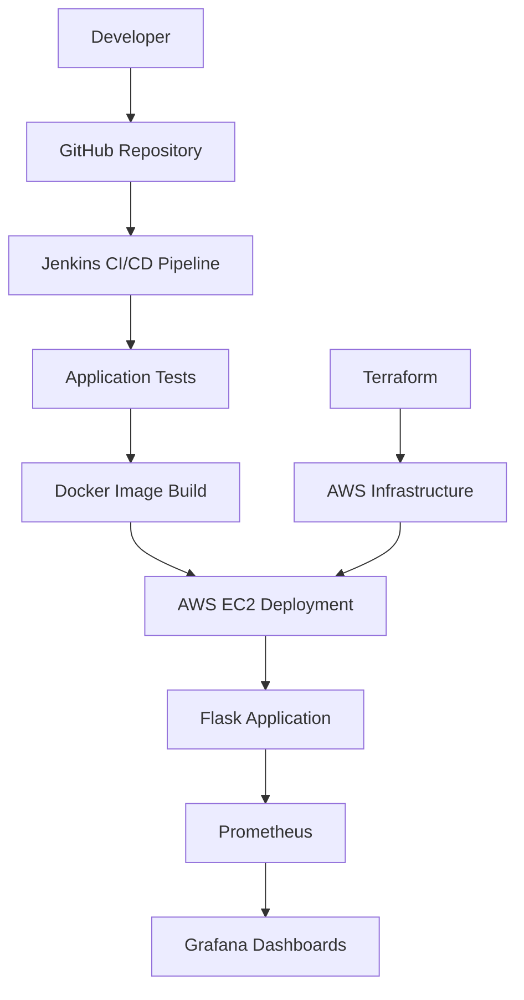

# End-to-End DevOps Practice Project

A hands-on DevOps project demonstrating application development, CI/CD automation, containerization, AWS infrastructure provisioning, monitoring, and Kubernetes fundamentals.

## Project Overview

This project uses a Python Flask application to practice an end-to-end DevOps workflow. GitHub manages source code, Jenkins automates the build and deployment process, Docker packages the application, and Terraform provisions AWS infrastructure.

Prometheus collects application metrics, and Grafana provides dashboards for monitoring application performance.

## Architecture



## Technologies Used

| Category | Technologies |
|---|---|
| Application | Python, Flask |
| Version Control | Git, GitHub |
| CI/CD | Jenkins |
| Containers | Docker |
| Cloud | AWS EC2, VPC, Subnets, Security Groups |
| Infrastructure as Code | Terraform |
| Monitoring | Prometheus, Grafana |
| Orchestration Practice | Kubernetes, kubectl |
| Operating Environment | Ubuntu on WSL, Docker Desktop |

## Project Features

- Developed a Flask web application with health-check and metrics endpoints.
- Managed source code and project changes using Git and GitHub.
- Created a Jenkins pipeline for application testing, Docker image building, and deployment.
- Containerized the application using Docker.
- Provisioned AWS networking and compute infrastructure using Terraform.
- Exposed application metrics for Prometheus collection.
- Configured Grafana dashboards to visualize application performance metrics.
- Set up a local Kubernetes environment and practiced Pod and ReplicaSet configurations.

## Application Endpoints

| Endpoint | Purpose |
|---|---|
| `/` | Returns a welcome message |
| `/health` | Provides a basic application health check |
| `/metrics` | Exposes Prometheus metrics |

## Repository Structure

```text
devops-practice/
├── app/
│   ├── app.py
│   ├── requirements.txt
│   └── monitoring/
├── cicd/
│   └── Jenkinsfile
├── docker/
├── grafana/
├── kubernetes/
│   ├── pod.yaml
│   └── replicaset.yaml
├── monitoring/
│   └── loki/
├── terraform/
│   ├── main.tf
│   ├── provider.tf
│   └── .terraform.lock.hcl
├── .gitignore
└── README.md
```

## Local Setup

### 1. Clone the repository

```bash
git clone https://github.com/likithliki58/devops-practice.git
cd devops-practice
```

### 2. Set up the Python application

```bash
cd app
python3 -m venv .venv
source .venv/bin/activate
pip install -r requirements.txt
```

### 3. Run the application

```bash
python app.py
```

Open `http://localhost:5000` in your browser.

Test the health endpoint:

```bash
curl http://localhost:5000/health
```

If the application is running, the endpoint should return `OK`.

## Docker

Build and run the application from the repository root, assuming the Dockerfile is located at `docker/Dockerfile`:

```bash
docker build -f docker/Dockerfile -t devops-app:1.0 .
docker run -d --name devops-app -p 5000:5000 devops-app:1.0
```

Check the container:

```bash
docker ps
docker logs devops-app
```

## CI/CD with Jenkins

The Jenkins pipeline automates the main delivery steps:

1. Retrieve the application source code from GitHub.
2. Install dependencies and run tests.
3. Build the Docker image.
4. Deploy the application to the configured environment.

The pipeline depends on the Jenkins agent, Docker access, credentials, and deployment configuration being set up correctly.

## AWS Infrastructure with Terraform

Terraform configuration is maintained in the `terraform/` directory.

Typical workflow:

```bash
cd terraform
terraform init
terraform fmt
terraform validate
terraform plan
```

**Cost and safety:** Review the plan before applying infrastructure changes. AWS resources such as EC2 instances and networking services may incur charges. Use `terraform destroy` when appropriate to remove resources created for practice, after checking what will be deleted.

Do not commit Terraform state files, credentials, or generated provider binaries.

## Monitoring with Prometheus and Grafana

Prometheus collects application metrics from the Flask metrics endpoint.

Grafana can use Prometheus as a data source to visualize metrics such as:

- HTTP request volume and request rate
- Application response time
- Error rate
- Available process and memory metrics

Metric availability depends on the exporters and instrumentation configured in the application.

## Kubernetes Practice

The `kubernetes/` directory contains Pod and ReplicaSet manifests for learning Kubernetes workload concepts.

The local Kubernetes environment is intended for practice and experimentation. It is separate from the AWS EC2 deployment unless explicitly configured otherwise.

## Learning Outcomes

- Understanding an end-to-end DevOps workflow
- Automating application delivery with Jenkins
- Building and running Docker containers
- Provisioning cloud infrastructure with Terraform
- Monitoring application metrics using Prometheus and Grafana
- Practicing Kubernetes workload configuration
- Managing project changes with Git and GitHub

## Future Improvements

- Expand automated test coverage.
- Improve application logging and log aggregation.
- Add deployment rollback and failure-handling strategies.
- Extend Kubernetes deployment and service configurations.
- Improve security through secrets management and least-privilege access.

---

**Project type:** Hands-on DevOps learning project  
**Source code:** [GitHub Repository](https://github.com/likithliki58/devops-practice)
